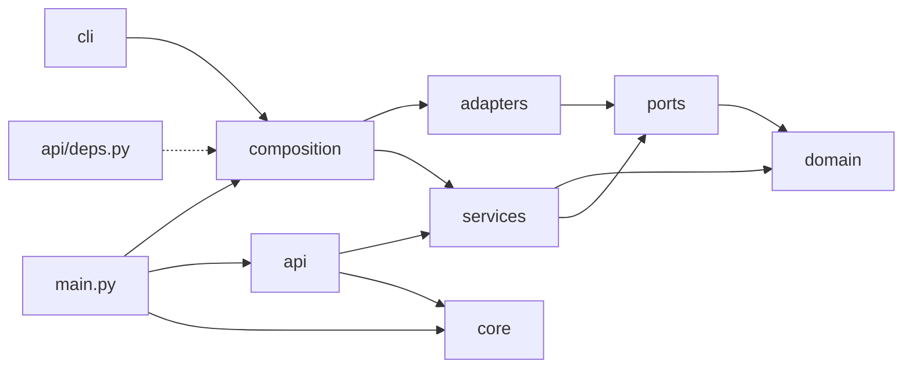

# ARCHITECTURE

Estado: 2026-11-21. Decisões: ADR 0001 (hexagonal, frontend por feature), ADR 0007 (usuários, SQLite WAL, composição), ADR 0008 (sessão), ADR 0009 (lockout), ADR 0010 (cache de imagem), ADR 0011 (proxy), ADR 0012 (backend serve o frontend), ADR 0013 (progresso e preferências no servidor), ADR 0014 (séries por pasta), ADR 0015 (metadados de fontes públicas), ADR 0016 (capas), ADR 0017 (CSP e iframe do EPUB; proposto), ADR 0018 (oitavo host e webhook; proposto), ADR 0019 (leitor único e ReaderSource; proposto).

## Backend: camadas

| Camada | Pasta | Estado |
|---|---|---|
| API (entrada HTTP) | `backend/app/api/` | health, auth, items, books (EPUB), series, library (scan e enriquecimento), progress, preferences, system (versão e atualização); SPA estática (`spa.py`); middlewares de cabeçalhos, CORS (condicional), rate limit, limite de corpo, CSRF |
| CLI (entrada admin) | `backend/app/cli.py` | `migrate`, `create-user`, `reset-password`, `deactivate-user`, `list-users`, `scan`, `enrich`, `purge` |
| Composição | `backend/app/composition.py`, `backend/app/main.py`, `backend/app/api/deps.py` | `Container` (lazy, sob trava) monta ports → adapters; `main.py` monta o app e a SPA; `deps.py` só expõe dependências |
| Services | `backend/app/services/` | `auth_service`, `user_service`, `scan`, `scan_runner`, `catalog`, `pages`, `hashing`, `progress_service`, `preferences_service`, `series_service`, `metadata_service`, `enrich_runner`, `book`, `update_service` |
| Domain | `backend/app/domain/` | `auth`, `user`, `password_policy`, `lockout`, `item`, `library`, `progress`, `preferences`, `series`, `metadata`, `book`, `release`, `errors` |
| Ports | `backend/app/ports/` | Existem (20 arquivos, sem contar `__init__.py`): `user_repository`, `refresh_token_repository`, `login_attempt_store`, `token_service`, `password_hasher`, `audit_log`, `clock`, `rate_limiter`, `storage`, `extractor`, `book_reader`, `item_repository`, `progress_repository`, `preferences_repository`, `series_repository`, `cover_store`, `http_gateway`, `metadata_provider`, `translator`, `update_notifier` |
| Adapters | `backend/app/adapters/` | `persistence/` (SQLAlchemy: db, models, usuários, refresh tokens, tentativas, auditoria, itens, progresso, preferências, séries, migrador), `security/` (Argon2id, JWT, rate limit em memória, relógio), `storage/` (`LocalStorage`, `cover_store.py` em `DATA_DIR/covers`), `extractors/` (CBZ, pasta, EPUB com `_epub_safe`, `_epub_html`, `_epub_css`; registro), `http/` (`safe_gateway.py`: única saída de conteúdo, ADR 0015; `webhook_notifier.py`: única saída fora dele, ADR 0018), `metadata/` (MangaDex, AniList, Wikipédia, Google Livros, MyMemory), `gate.py` (concorrência limitada) |
| Core (config) | `backend/app/core/` | `config.py` (`Settings`, `get_settings()` com cache; `APP_VERSION` e `UPDATE_*`), `keys.py` (subchaves HKDF) |
| Migrações | `backend/migrations/` | `env.py`, `script.py.mako`, `versions/0001` a `0008` |

## Regra de dependência (import-linter, `backend/pyproject.toml`, 8 contratos)

| Contrato | Origem | Proibido importar |
|---|---|---|
| domain is pure | `app.domain` | ports, services, adapters, api, core, main, composition, fastapi, sqlalchemy, pydantic, pydantic_settings, starlette, httpx, jwt, argon2, alembic |
| ports only depend on domain | `app.ports` | services, adapters, api, core, main, composition, fastapi, starlette, sqlalchemy, pydantic, pydantic_settings, jwt, argon2, alembic |
| services only depend on domain and ports | `app.services` | adapters, api, core, main, composition, fastapi, starlette, sqlalchemy, pydantic, pydantic_settings, jwt, argon2, alembic |
| core does not depend on application layers | `app.core` | api, services, adapters, main |
| adapters do not depend on api or services | `app.adapters` | api, services, main, composition, fastapi, starlette |
| main only wires api, composition and core | `app.main` | adapters, services, ports, domain, sqlalchemy, alembic, argon2, jwt (indireto permitido) |
| cli only reaches adapters through composition | `app.cli` | adapters, sqlalchemy (indireto permitido) |
| api does not import adapters (except deps) nor sqlalchemy | `app.api` | adapters, composition, sqlalchemy, jwt, argon2, alembic; exceção: `app.api.deps -> app.composition` (indireto permitido) |

Não há exceção para `app.adapters` em `app.api.deps`. `unmatched_ignore_imports_alerting = "error"`: exceção sem correspondente quebra o teste. Os contratos não mudaram nesta entrega (8 nomes, `backend/pyproject.toml`).

Verificação: `backend/tests/architecture/test_layers.py` executa `importlinter.cli` de verdade (`KEPT` exigido). Cada item de `forbidden_modules` tem caso negativo; um teste exige exatamente os 8 nomes de contrato. Violação quebra o teste.

## Frontend: fronteiras

Dependency-cruiser (`frontend/.dependency-cruiser.cjs`, verificação `npm run arch`): feature não importa feature nem `app`; `shared` não importa `features` nem `app`; sem ciclos; import resolvível; `src` não depende de devDependencies. Regras ESLint em `frontend/eslint.config.js` (canais de rede e `indexedDB` por pasta; `localStorage` e `sessionStorage` proibidos em todo lugar).

Estrutura real: `app/` (rotas, providers, SW, aviso de versão, escolha do leitor) → `features/` (telas: `auth`, `library`, `reader/` (`manga`, `epub`; `sources` = Strategy `ReaderSource`, ainda sem uso na UI), `settings`, `series`; esqueleto `reader-pdf`; `progress` só README) → `shared/` (`api-client`, `session`, `preferences`, `progress` (com flush-registry), `items` (com `useItem`), `series` (com `useReaderNav`), `system` (versão e aviso), `pwa` (estado do SW), `hooks`, `theme`, `ui`; `offline` só README).

Cada feature usa `shared/` para dados (sessão, preferências, progresso, itens, séries, versão). Features não importam umas às outras.

## Diagrama

Frontend: `app → features → shared` (`features` e `shared` nunca importam `app`).

## Fluxo de uma requisição HTTP

| Passo | Onde |
|---|---|
| 1. Proxy TLS (fora do escopo) | servidor |
| 2. uvicorn `--proxy-headers --forwarded-allow-ips $FORWARDED_ALLOW_IPS` define o IP do cliente | `infra/entrypoint.sh`, `backend/app/api/http_utils.py` |
| 3. Cabeçalhos de segurança e 500 genérico (externo a tudo) | `api/security_headers.py` |
| 4. CORS (só com `ALLOWED_ORIGINS`) | `main.py` |
| 5. Rate limit por IP (global `/api`; estrito só em login, refresh, logout e troca de senha) | `api/rate_limit.py` |
| 6. Limite de corpo (413) | `api/body_limit.py` |
| 7. CSRF em métodos não seguros (403), só em `/api` | `api/csrf.py` |
| 8. Router | `api/health.py`, `auth.py`, `items.py`, `books.py`, `series.py`, `library.py`, `progress.py`, `preferences.py`, `system.py` |
| 9. Dependência `get_current_user`: JWT e checagem no banco | `api/deps.py` → `services/auth_service.py` → adapters |
| 10. Caso de uso e mapeamento de erro genérico | `services/*`, `api/errors.py` |
| 11. Resposta com cabeçalhos e cookies | `api/auth.py`, `api/items.py`, `api/books.py`, `api/progress.py` |

Fora de `/api` (sem rota de API que case): SPA em `api/spa.py` (ver abaixo).

Ordem de montagem (`main.py`): o último `add_middleware` é o mais externo. Caminho: SecurityHeaders → CORS → RateLimit → BodyLimit → CSRF → rotas. `install_spa` é o `router.default`, instalado depois dos routers.

## Fluxo de entrega do frontend (SPA)

| Passo | Onde |
|---|---|
| 1. Só se `FRONTEND_DIST_DIR` estiver definido (imagem: `/app/static`) | `core/config.py`, `main.py` |
| 2. Caminho fora de `/api`: validado (sem `..`, dotfile, `\`, `:`, NUL) e resolvido dentro da raiz, sem symlink | `api/spa.py` |
| 3. Arquivo existe → `FileResponse` (com `Range`); senão, caminho sem extensão → `index.html`; com extensão → 404 | `api/spa.py` |
| 4. Cache: `assets/*` imutável; demais `no-cache` | `api/spa.py` |
| 5. Cabeçalhos (CSP explícita) | `api/security_headers.py` (ADR 0012) |

## Fluxo de login

| Passo | Onde |
|---|---|
| 1. Bloqueio verificado e falha reservada sob trava de processo | `services/auth_service.py` (`_begin_attempt`) |
| 2. Argon2id (ou hash dummy) com gate de 2 slots | `adapters/security/argon2_hasher.py`, `adapters/gate.py` |
| 3. Sucesso: libera reserva, zera contadores da conta, cria família de refresh | `auth_service.py`, `refresh_token_repository.py` |
| 4. Access JWT (HS256) e cookies | `adapters/security/jwt_tokens.py`, `api/auth.py` |

## Fluxo de progresso

| Passo | Onde |
|---|---|
| 1. `PUT /api/v1/progress/{id}` com `locator` (e `device_id` opcional); `user_id` vem do token | `api/progress.py`, `api/deps.py` |
| 2. Item por id (ausente ou marcado como ausente = 404) | `services/progress_service.py` → `adapters/persistence/item_repository.py` |
| 3. `percent` e `finished` calculados pelo tipo do item (página ou capítulo + offset; locator fora = 422) | `domain/progress.py` (`compute_position`, `compute_book_position`) |
| 4. `updated_at` pelo relógio do servidor; upsert atômico; último a gravar vence | `services/progress_service.py`, `adapters/persistence/progress_repository.py` (ADR 0013) |
| 5. `GET /progress/continue`: não concluídos, item não ausente, mais recente primeiro (limite capado em 50) | `progress_repository.py` (`list_continue`) |

## Fluxo de leitura de página

| Passo | Onde |
|---|---|
| 1. Item por id opaco, do banco | `adapters/persistence/item_repository.py` |
| 2. Caminho relativo validado e resolvido | `adapters/storage/local.py` |
| 3. Índice do arquivo em cache LRU (64) por (rel_path, size, mtime_ns) | `adapters/extractors/_common.py`, `cbz.py`, `folder.py` |
| 4. Leitura do corpo sob gate (4 leitores, 16 em espera, 2 s) | `adapters/extractors/_common.py` (`default_read_gate`) |
| 5. Validação por bytes mágicos e cabeçalhos da resposta | `api/items.py` (`image_response`) |

## Fluxo de leitura de livro (EPUB, ADR 0017)

| Passo | Onde |
|---|---|
| 1. Item `book` por id opaco; outro tipo = 404 | `services/book.py` (`_load`), `api/books.py` |
| 2. Leitor pelo formato (`epub`), registrado em `extractors/registry.py` | `adapters/extractors/registry.py` (`book_readers`) |
| 3. Pacote lido com limites e sem caminho externo; DRM recusado | `adapters/extractors/epub.py`, `_epub_safe.py` |
| 4. Capítulo: HTML sanitizado por allowlist; CSS por allowlist; imagens viram `/book/res/{rid}` | `adapters/extractors/_epub_html.py`, `_epub_css.py`, `epub.py` |
| 5. Resposta com ETag e marcador interno; CSP do capítulo pelo middleware | `api/books.py`, `api/security_headers.py` |
| 6. Tela: frame `sandbox="allow-same-origin"`; progresso pelo locator capítulo × 10000 + offset | `frontend/src/features/reader/epub/`, `shared/items/api.ts` |

## Fluxo de scan

| Passo | Onde |
|---|---|
| 1. Disparo: `POST /api/v1/library/scan` (admin) ou `python -m app.cli scan` | `api/library.py`, `cli.py` |
| 2. Uma varredura por vez; thread de fundo (API) ou síncrona (CLI) | `services/scan_runner.py` |
| 3. Varredura incremental (size+mtime), erro por arquivo sem abortar | `services/scan.py`, `adapters/storage/local.py` |
| 4. Remoção de sumidos só se a caminhada estiver saudável | `services/scan.py` (`removal_skipped`) |
| 5. Status só com contagens e nomes de classe de erro | `services/scan_runner.py`, `api/library_schemas.py` |

Não há cancelamento de scan (pendência registrada em `SECURITY_MAP.md`).

## Fluxo de séries

| Passo | Onde |
|---|---|
| 1. Agrupamento no scan: pasta pai = série; arquivo na raiz = série avulsa; número do capítulo pelo nome | `domain/series.py` (`group_entry`, `parse_chapter_number`), `services/scan.py` |
| 2. Lista: séries com capítulo ativo, por `sort_title` | `adapters/persistence/series_repository.py` (`list_summaries`) |
| 3. Detalhe: capítulos em ordem, progresso do usuário, campo `continue`, `kind` derivado | `services/series_service.py`, `domain/series.py` (`sort_chapters`, `pick_continue`, `series_kind`) |
| 4. Capa: a baixada (se legível) ou a do primeiro capítulo legível | `services/series_service.py` (`get_series_cover`), `adapters/storage/cover_store.py` |

## Fluxo de metadados (ADR 0015)

| Passo | Onde |
|---|---|
| 1. Disparo: `POST /api/v1/library/enrich` (admin, 202, em segundo plano) ou `python -m app.cli enrich` (síncrono) | `api/library.py`, `cli.py`, `services/enrich_runner.py` |
| 2. Uma execução por vez; até `METADATA_MAX_PER_RUN` séries; elegibilidade pelo estado (`manual` nunca; formato não importa) | `services/metadata_service.py` (`enrich_all`, `_eligible`) |
| 3. Busca em MangaDex e AniList (obra); Wikipédia e Google Livros só com casamento forte | `adapters/metadata/*.py`, `domain/metadata.py` (`pick_best`) |
| 4. Fusão: capa e fonte pela primeira obra com capa; descrição pt-br > fonte só-descrição > tradução > original | `services/metadata_service.py` (`_apply_work`, `_resolve_description`) |
| 5. Toda saída de conteúdo passa pelo `SafeGateway` (lista fixa de 8 hosts) | `adapters/http/safe_gateway.py` |
| 6. Escrita: capa em arquivo temporário; banco aceita sob condição do estado atual; depois renomeação e remoção da capa antiga | `services/metadata_service.py`, `adapters/storage/cover_store.py` (ADR 0016) |
| 7. Ação do admin: busca ao vivo (10/min por usuário), `select`, `PUT` e `DELETE` de metadados | `api/series.py`, `services/metadata_service.py` (`candidates`, `select`, `set_manual`, `clear`) |

## Fluxo de versão e atualização (ADR 0018)

| Passo | Onde |
|---|---|
| 1. Versão em execução: `APP_VERSION` (imagem, do build da release; `dev` desliga) | `core/config.py`, `infra/Dockerfile` |
| 2. Consulta preguiçosa da última release quando um admin vê a versão e o cache venceu (`UPDATE_CHECK_INTERVAL_HOURS`); single-flight; ETag | `services/update_service.py`, `adapters/http/safe_gateway.py` (`get_json_conditional`, `api.github.com`) |
| 3. Aviso no app só para admin; texto puro; link https do repositório | `api/system.py`, `frontend/src/shared/system/` |
| 4. Aprovação do admin: `POST /system/update` com a tag exata da última release; pedido em memória; auditoria sem URL | `api/system.py`, `services/update_service.py` (`request_update`) |
| 5. Webhook assinado (HMAC-SHA256) para o destino de configuração; https, ou http só em rede do operador | `adapters/http/webhook_notifier.py`, `domain/release.py` (`is_operator_network`) |
| 6. Receptor no host: verifica assinatura, janela, nonce, repositório e tag; `docker compose pull` e `up -d`; healthcheck; reverte se falhar | `infra/deploy-hook/receiver.py` (fora do app; o app nunca acessa o Docker) |

## Fluxo administrativo (CLI)

| Passo | Onde |
|---|---|
| 1. `python -m app.cli <comando>` | `backend/app/cli.py` |
| 2. `build_container()`, `build_user_service()`, `run_migrations()` | `backend/app/composition.py` |
| 3. Engine SQLite, sessão e adaptadores | `adapters/persistence/` |
| 4. Regras de conta | `services/user_service.py` → `domain/user.py`, `domain/password_policy.py` |

Senha só por `getpass`; nunca em argumento nem na saída.

## Infra e entrega (empacotamento, CI e release)

| Item | Estado |
|---|---|
| Imagem | `infra/Dockerfile`: 3 estágios. (1) `node:24.21.0-slim` builda o frontend; (2) `python:3.12.8-slim` instala o backend com `PIP_CONSTRAINT=/constraints.txt` em `/install`; (3) runtime `python:3.12.8-slim`, usuário `app` (uid 10001), pip/setuptools/wheel removidos, `/app/static` com o frontend, `ENTRYPOINT` `entrypoint.sh`, HEALTHCHECK em Python; `ARG APP_VERSION` |
| Publicação | `ghcr.io/andre-bueno/biblioteca-pwa`, por tag (`release.yml`): `vX.Y.Z` e `X.Y.Z`; `latest` só em release final; proveniência e SBOM ligados |
| CI | `.github/workflows/ci.yml` (push em `master`, pull request e reuso pelo release): backend, frontend, testes de infra, gitleaks, build da imagem sem push |
| Release | `.github/workflows/release.yml`: `prepare` → `verify` (chama `ci.yml`) → `publish` → `release` |
| Entrypoint | `infra/entrypoint.sh`: valida `SECRET_KEY` e `FORWARDED_ALLOW_IPS`, roda `migrate` e faz `exec uvicorn` com limites |
| Dependências | `infra/constraints.txt` (gerado por `infra/gen_constraints.sh` dentro de `python:3.12.8-slim`); sem hashes (M8) |
| Proxy confiável | Única fonte do IP real: `FORWARDED_ALLOW_IPS`, obrigatória e sem padrão, no compose e no entrypoint (ADR 0011). Não há `ENV` dele no Dockerfile |
| Compose | `infra/compose.example.yml`: imagem `ghcr.io/andre-bueno/biblioteca-pwa:${APP_TAG:-latest}` com `build:`; porta `${BIND_ADDRESS:-127.0.0.1}:${HOST_PORT:-8000}`; `read_only`; `tmpfs /tmp`; `no-new-privileges`; `cap_drop: ALL`; `stop_grace_period`, `pids_limit`, `mem_limit`, `restart`; rede com sub-rede fixa `${NETWORK_SUBNET:-172.30.77.0/24}`; `../library:/library:ro`; volume `app-data` em `/data`; `DATABASE_URL=sqlite:////data/app.db` |
| Migração na imagem | `python -m app.cli migrate` a cada subida (entrypoint), com `MIGRATIONS_DIR=/app/migrations` |
| Dados | `/data` (volume `app-data`): banco e `covers/`; `ENV DATA_DIR=/data` na imagem |
| Validação | Build, `up`, `healthy`, rotas, login com CSRF, scan e não-root validados em 2026-11-20; build e teste com a biblioteca real em 2026-11-21 (relatado pelo dono; ver `docs/DEPLOY.md`). CI e release ainda não rodaram nesta entrega |
| Guia | `docs/DEPLOY.md` |

## Não existe ainda

| Item | Previsto em |
|---|---|
| Arquivo PDF com Range (`/items/{id}/file`) | PLANO §5, Fase 4 |
| Extratores CBR e PDF | PLANO §3, Fase 4 |
| Endpoint admin de criação de conta (só CLI) | PLANO §6 |
| Cancelamento de scan | nenhum requisito; YAGNI (`scan_runner.py`) |
| Teste que falha se houver módulo fora do CODEMAP | `docs/AGENTS.md` (planejado) |
| Leitor PDF; tela própria de progresso | PLANO §2, Fase 4 |
| Offline (`shared/offline`) | PLANO §2, Fase 5 |
| E2E (Playwright) | `frontend/tests/e2e/` vazio |
| Rate limit por rota (páginas, scan) | PLANO §6 |
