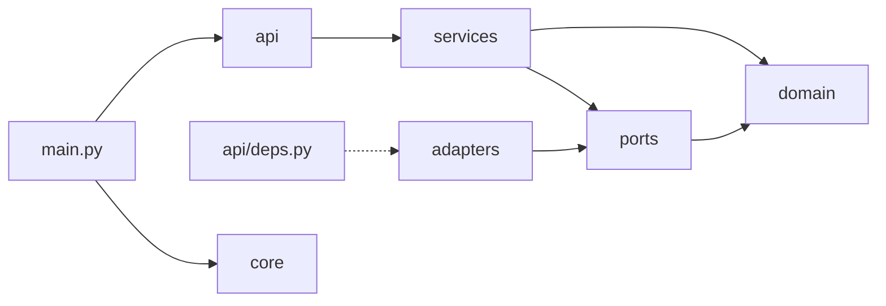

# ARCHITECTURE

Estado: 2026-11-19. Decisão: `docs/adr/0001-arquitetura-hexagonal-e-frontend-por-feature.md`.

## Backend: camadas

| Camada | Pasta | Estado |
|---|---|---|
| API (entrada) | `backend/app/api/` | Existe: health, middleware de cabeçalhos e erro 500 |
| Composição | `backend/app/main.py`, `backend/app/api/deps.py` | `main.py` existe (`create_app()` carrega `Settings`); `deps.py` sem código |
| Services | `backend/app/services/` | Vazio (pacote) |
| Domain | `backend/app/domain/` | Vazio (pacote) |
| Ports | `backend/app/ports/` | Vazio (pacote) |
| Adapters | `backend/app/adapters/{persistence,storage,extractors}/` | Vazio (pacotes) |
| Core (config) | `backend/app/core/` | Existe: `Settings`, lido por `create_app()` e guardado em `app.state.settings` |

## Regra de dependência (import-linter, `backend/pyproject.toml`)

| Contrato | Origem | Proibido importar |
|---|---|---|
| domain is pure | `app.domain` | ports, services, adapters, api, core, main, fastapi, sqlalchemy, pydantic, starlette, httpx |
| ports only depend on domain | `app.ports` | services, adapters, api, core, main, fastapi, sqlalchemy |
| services only depend on domain and ports | `app.services` | adapters, api, core, main, fastapi, sqlalchemy |
| core does not depend on application layers | `app.core` | api, services, adapters, main |
| adapters do not depend on api or services | `app.adapters` | api, services, main |
| api does not import adapters (except deps) nor sqlalchemy | `app.api` | adapters, sqlalchemy; exceção: `app.api.deps -> app.adapters(.*)` |

Verificação: `backend/tests/architecture/test_layers.py` executa `importlinter.cli` de verdade (`KEPT` exigido), com 33 casos negativos parametrizados (um módulo proposital por item de `forbidden_modules`), um controle positivo e testes da exceção `api.deps`. Violação quebra o teste.

## Frontend: fronteiras (dependency-cruiser, `frontend/.dependency-cruiser.cjs`)

| Regra | Severidade | Significado |
|---|---|---|
| feature-not-import-other-feature | error | Feature não importa outra feature (inclui `import type`) |
| feature-not-import-app | error | Feature não importa `src/app/` |
| shared-not-import-features-or-app | error | `shared/` não importa `features/` nem `app/` |
| no-circular | error | Sem ciclos |
| not-to-unresolvable | error | Todo import resolve (exceto `virtual:`) |
| not-to-dev-dep | error | `src/` não depende de devDependencies (exceto `.d.ts`) |

Verificação: `npm run arch` e `frontend/tests/unit/architecture.test.ts` (`src` sem violação; 8 fixtures em `frontend/tests/fixtures/arch-*/`, cada uma deve disparar sua regra).

Regras ESLint (`frontend/eslint.config.js`): `fetch`, `XMLHttpRequest`, `WebSocket` e `navigator.sendBeacon` só em `src/shared/api-client/`; `indexedDB` só em `src/shared/offline/`; `localStorage` e `sessionStorage` bloqueados em todo lugar, inclusive via `window`/`globalThis`/`self`; `react/no-danger`; `no-eval`; plugin `security`. Acessos indiretos (alias, desestruturação) não são detectados e dependem de revisão.

## Diagrama

Frontend: `app → features → shared` (`features` e `shared` nunca importam `app`).

## Fluxo de uma requisição (hoje)

| Passo | Onde |
|---|---|
| 1. Proxy TLS (fora do escopo) | servidor |
| 2. uvicorn `--proxy-headers --forwarded-allow-ips $FORWARDED_ALLOW_IPS` → `app.main:app` | `infra/Dockerfile`, `backend/app/main.py` |
| 3. Middleware de cabeçalhos (e 500 JSON genérico em exceção) | `backend/app/api/security_headers.py` |
| 4. Router `/api/v1/health` | `backend/app/api/health.py` |
| 5. Resposta JSON `{"status": "ok"}` com cabeçalhos | — |

Frontend: `HomePage` → `useHealth` → `apiClient.get` (`shared/api-client/client.ts`). Com `VITE_API_BASE_URL` vazio, `credentials: same-origin`; `include` só quando a origem da API é outra e configurada.

## Infra (empacotamento)

| Item | Estado |
|---|---|
| Imagem | `infra/Dockerfile`: `python:3.12.8-slim`, usuário `app` (uid 10001), `pip install .`, HEALTHCHECK em Python |
| Contexto de build | raiz do repositório (`.dockerignore` na raiz) |
| Compose | `infra/compose.example.yml`: porta `${BIND_ADDRESS:-127.0.0.1}:${HOST_PORT:-8000}`, `read_only`, `cap_drop: ALL`, biblioteca `:ro` |
| Proxy confiável | Única fonte do IP real: `FORWARDED_ALLOW_IPS` (uvicorn). Compose e `.env.example`: `172.17.0.1`. Dockerfile `ENV`: `127.0.0.1` (divergente, em aberto; ver `SECURITY_MAP.md`) |
| Validação | Build da imagem e `docker compose up` não executados |

## Não existe ainda

| Item | Previsto em |
|---|---|
| Autenticação e sessões | PLANO §6, Fase 1 |
| Banco e migrações (SQLAlchemy/Alembic; `backend/migrations/`) | PLANO §4, §7, Fase 1 |
| Extractors CBZ/CBR/EPUB/PDF e storage | PLANO §3, Fase 1/4 |
| Casos de uso (scan, progresso, páginas) | PLANO §3, Fase 1 |
| Ponto de composição ports → adapters | ADR 0001, Fase 1 |
| CORS, CSRF server-side, rate limit | PLANO §6, Fase 1 |
| `Cache-Control: no-store` em respostas autenticadas | PLANO §6, Fase 1 |
| Teste que falha se houver módulo fora do CODEMAP | planejado (`docs/AGENTS.md`) |
| Rotas de telas além de `/` | PLANO §2, Fases 2–4 |
